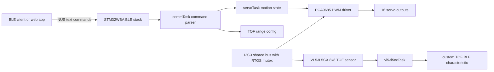

# ServoWebController Firmware


Firmware for a BLE-controlled robotics controller built on STM32WBA. It receives simple text commands over Bluetooth Low Energy, drives up to 16 hobby servos through a PCA9685 PWM controller, and includes an integration path for an 8x8 VL53L5CX time-of-flight sensor.

This project is both a practical embedded system and a learning platform. It demonstrates RTOS task design, BLE GATT integration, shared I2C access, command parsing, servo motion control, sensor bring-up, and the kind of hardware/software debugging that turns a board into a working robot controller.

## What It Does

- Controls up to 16 servo channels through a PCA9685 I2C PWM driver
- Accepts BLE commands through a Nordic UART Service style text protocol
- Supports immediate servo positioning and timed interpolated movement
- Runs communication, servo motion, and sensor work in separate FreeRTOS tasks
- Shares the I2C bus safely between the PCA9685 and VL53L5CX paths
- Includes VL53L5CX distance-map acquisition and custom BLE service code for TOF telemetry
- Keeps STM32Cube-generated code separated from hand-written application modules

## Why This Exists

The goal is to make a robotics firmware project that is easy to inspect, easy to extend, and real enough to be interesting. A beginner can connect a BLE terminal and move a servo. A more advanced developer can study the task boundaries, command protocol, generated-code integration, BLE services, and hardware drivers.

This repository is also meant to be portfolio-readable: if you are reviewing it as an embedded systems project, good places to start are the communication parser, servo task, shared I2C wrapper, PCA9685 driver, and STM32_WPAN BLE application glue.

## System Architecture



The firmware follows a simple split:

- BLE receives bytes and hands command text into the application layer.
- The communication task parses commands and validates arguments.
- The servo task owns servo state and timed motion interpolation.
- Low-level drivers handle PCA9685 PWM output and VL53L5CX sensor access.
- Shared I2C helpers serialize bus access across RTOS tasks.

## Hardware Target

The current project is configured around:

- STM32WBA5M based board, currently the B-WBA5M-WPAN discovery board
- PCA9685 16-channel PWM servo driver on I2C
- VL53L5CX 8x8 time-of-flight sensor on I2C
- Standard hobby servos
- External servo power supply sized for the connected motors

Typical servo pulse settings are:

- Channels: `0` to `15`
- Neutral pulse: `1500 us`
- Driver clamp range: `500 us` to `2500 us`
- PWM frequency: `50 Hz`

## Hardware Wiring

The external servo driver and TOF sensor are both intended to share the firmware's `I2C3` bus. In the CubeMX project and generated STM32 HAL code, this bus is configured on `PA6` and `PA7`.

| Firmware signal | STM32WBA pin | Cube label | Connect to |
| --- | --- | --- | --- |
| `I2C3_SCL` | `PA6` | `I2C_SCL` | PCA9685 `SCL` and VL53L5CX-SATEL `SCL` |
| `I2C3_SDA` | `PA7` | `I2C_SDA` | PCA9685 `SDA` and VL53L5CX-SATEL `SDA` |
| `3V3` | Board 3.3 V rail | Logic power | PCA9685 `VCC`, VL53L5CX-SATEL `IOVDD` |
| `GND` | Board ground | Common ground | PCA9685 `GND`, VL53L5CX-SATEL `GND`, servo supply ground |

The I2C pins are configured as open-drain alternate-function pins with no internal pull-up. The bus therefore needs pull-ups to `3V3`. Many PCA9685 and VL53L5CX breakout boards already include pull-ups; if several boards are connected, check the combined pull-up value.

B-WBA5M-WPAN note: the firmware uses `PA6/PA7` on `I2C3`. The ST board manual maps these pins to the onboard MEMS I2C bus. The M.2 E-Key host I2C pins are `PB2/PB3` on `I2C1`, and are not used by this firmware without porting the code to a different I2C instance.

Official board reference: [UM3450 B-WBA5M-WPAN user manual](https://www.st.com/resource/en/user_manual/um3450-bluetooth-le-connectivity-expansion-board-for-stm32-boards-based-on-the-stm32wba5mmg-module-stmicroelectronics.pdf).

### PCA9685 Connections

The PCA9685 is the 16-channel PWM chip that actually drives the servo signal pins.

| PCA9685 pin | Connect to | Notes |
| --- | --- | --- |
| `VCC` | `3V3` | Logic supply for I2C. Do not feed 5 V logic into the STM32 I2C pins. |
| `GND` | Common `GND` | Must be common with STM32 ground and external servo supply ground. |
| `SCL` | STM32 `PA6` / `I2C3_SCL` | Shared I2C clock. |
| `SDA` | STM32 `PA7` / `I2C3_SDA` | Shared I2C data. |
| `OE` | `GND` or board default enable | Current firmware does not drive an output-enable GPIO. |
| `V+` | External servo supply, usually 5 V to 6 V | Powers the servos only. Size this supply for servo stall current. |
| `PWM0`..`PWM15` | Servo signal wires | Firmware channels `0`..`15` map to these outputs. |
| `A0`..`A5` | Address jumpers | Default 7-bit address is `0x40`; firmware scans `0x40` through `0x77`. |

Servo wiring is the normal three-wire hobby-servo layout: signal to one PCA9685 PWM output, positive servo power to the PCA9685 `V+` rail, and servo ground to the shared ground.

### VL53L5CX-SATEL Connections

The current firmware talks to the VL53L5CX by polling over I2C. It does not currently assign STM32 GPIOs for `PWREN`, `LPn`, `I2C_RST`, or `INT`.

| VL53L5CX-SATEL pin | Name | Connect to this firmware | Notes |
| --- | --- | --- | --- |
| `1` | `GND` | Common `GND` | Shared with STM32, PCA9685, and servo supply ground. |
| `2` | `IOVDD` | `3V3` | I/O voltage for the SATEL board. |
| `3` | `AVDD` | `5V` on the full SATEL board | ST's full SATEL flying-lead example powers `AVDD` from 5 V. If using the detached mini-PCB, follow ST's 3.3 V mini-PCB wiring guidance. |
| `4` | `PWREN` | Tie enabled, or add a GPIO in future firmware | No GPIO is assigned in the current code. |
| `5` | `LPn` | Tie high, or add a GPIO in future firmware | No low-power control pin is assigned in the current code. |
| `6` | `SCL` | STM32 `PA6` / `I2C3_SCL` | Shared I2C clock. |
| `7` | `SDA` | STM32 `PA7` / `I2C3_SDA` | Shared I2C data. |
| `8` | `I2C_RST` | Leave at board default, or add a GPIO in future firmware | No sensor reset GPIO is assigned in the current code. |
| `9` | `INT` | Not connected | Firmware currently uses polling, not the interrupt pin. |

The VL53L5CX driver uses ST's default `0x52` I2C address constant, which corresponds to the common 7-bit bus address `0x29`.

## BLE Interface

The firmware advertises as:

```text
BleServoCtl
```

Main BLE UUIDs defined by the project:

| Purpose | UUID |
| --- | --- |
| Nordic UART Service | `6E400001-B5A3-F393-E0A9-E50E24DCCA9E` |
| NUS RX characteristic | `6E400002-B5A3-F393-E0A9-E50E24DCCA9E` |
| NUS TX characteristic | `6E400003-B5A3-F393-E0A9-E50E24DCCA9E` |
| TOF service | `91BAD492-B950-4226-AA2B-4EDE9FA42F59` |
| TOF distance-map characteristic | `91BAD493-B950-4226-AA2B-4EDE9FA42F59` |

Commands are plain text, case-sensitive, and designed to be easy to send from a BLE terminal, script, or companion web application. Arguments may be decimal or `0x` hexadecimal. Spaces, tabs, commas, colons, semicolons, carriage returns, and line feeds are accepted as separators.

Successful replies begin with `OK`. Error replies begin with `-`.

## Command Reference

| Command | Description |
| --- | --- |
| `PING` | Health check. Returns `OK PING`. |
| `SET_DIRECT <channel> <pulse_us>` | Immediately sets one servo channel target pulse. |
| `SET_TIMING <channel> <pulse_us> <duration_ms>` | Moves one servo channel to a target pulse over a duration. |
| `TOF_SET_MIN_MAX <min_mm> <max_mm>` | Sets the distance scaling window used by the TOF BLE payload. |

Example session:

```text
PING
OK PING

SET_DIRECT 0 1500
OK SET_DIRECT 0 1500

SET_TIMING 3 2200 1000
OK SET_TIMING 3 2200 1000

TOF_SET_MIN_MAX 200 1200
OK TOF_SET_MIN_MAX 200 1200
```

## Repository Tour

The project contains STM32Cube-generated code, vendor middleware, and hand-written application code. The most important custom firmware areas are:

| Path | Purpose |
| --- | --- |
| `agent.md` | Top-level firmware map for future maintainers and agents. |
| `BleServoController.ioc` | STM32CubeMX project configuration. |
| `Core/Src/app_freertos.c` | FreeRTOS object creation and task startup. |
| `Core/Src/app_entry.c` | STM32 wireless stack entry points and app dispatch. |
| `STM32_WPAN/App/` | BLE services, advertising, NUS transport, DIS, OTA, and TOF service code. |
| `STM32CubeIDE/Application/User/Core/config.h` | Feature flags, device name, watchdog flag, and TOF defaults. |
| `STM32CubeIDE/Application/User/Core/comm/` | Text command parser and command dispatch layer. |
| `STM32CubeIDE/Application/User/Core/servo/` | Servo runtime state and timed motion interpolation. |
| `STM32CubeIDE/Application/User/Core/PCA9685/` | PCA9685 PWM and servo pulse driver. |
| `STM32CubeIDE/Application/User/Core/i2c_os/` | RTOS-aware shared I2C helper layer. |
| `STM32CubeIDE/Application/User/Core/VL53L5CX/` | VL53L5CX task, platform glue, payload encoding, and vendor sensor driver. |

Generated-code boundaries matter in this repository. When changing STM32Cube-generated files, use the existing `USER CODE` sections and check the local `agents.md` notes in each area.

## Build And Flash

The project is set up for STM32CubeIDE.

1. Open the repository in STM32CubeIDE.
2. Import the existing STM32 project.
3. Confirm that the STM32WBA support package required by the project is installed.
4. Build the active configuration.
5. Flash the target board.
6. Connect from a BLE client to `BleServoCtl`.
7. Send `PING` over the NUS RX characteristic and verify the `OK PING` response.

The main CubeMX configuration file is:

```text
BleServoController.ioc
```

## Companion Web App

The firmware protocol is intended to stay aligned with the companion web application in the sibling repository:

```text
../ServoWebController-Web
```

That app can act as a higher-level BLE control surface, while the firmware remains usable from any BLE client that can write text to the NUS RX characteristic and read notifications from NUS TX.

## Project Status

This is active firmware development, not a sealed commercial product.

- Servo command path over BLE NUS is implemented.
- PCA9685 servo output and timed motion support are implemented.
- VL53L5CX task and TOF BLE service code are present.
- TOF streaming should be verified against the current BLE application wiring before relying on distance-map notifications in a demo.
- The independent watchdog is currently disabled during bring-up through the project configuration.

## Safety Notes

Servos can draw much more current than a USB debug connection can safely provide.

- Use a dedicated servo power supply sized for the number and load of connected servos.
- Connect grounds between the MCU board, servo supply, PCA9685 board, and sensors.
- Keep fingers, wires, and loose parts away from moving linkages.
- Start with one servo before connecting a full mechanism.
- Treat sensor-driven motion as experimental until limits and failsafes are tested.

## Ideas For Contributors

Good first improvements:

- Add more BLE command examples and host-side scripts.
- Add a small desktop or web-based test client.
- Expand command validation tests.
- Add motion presets or synchronized multi-servo moves.
- Finish and document the TOF notification path end to end.
- Add wiring diagrams and photos for common hardware setups.

## For Reviewers

If you are looking at this as a portfolio project, these files show the most relevant engineering work:

- `STM32CubeIDE/Application/User/Core/comm/comm_interface.c`
- `STM32CubeIDE/Application/User/Core/servo/servo_task.c`
- `STM32CubeIDE/Application/User/Core/PCA9685/pca9685.c`
- `STM32CubeIDE/Application/User/Core/i2c_os/i2c_os.c`
- `STM32CubeIDE/Application/User/Core/VL53L5CX/vl53l5cx_task.c`
- `STM32_WPAN/App/nus_app.c`
- `STM32_WPAN/App/app_ble.c`

They show the main application flow from BLE input to parsed command to RTOS task behavior to hardware output.

## License

This repository is released under the MIT License. See `LICENSE`.

The repository also includes vendor and middleware code from ST, CMSIS, FreeRTOS, and sensor support packages. Keep their original notices and license files intact when redistributing.

## Author

Created by Netanel Unger as an embedded robotics and BLE firmware project.
